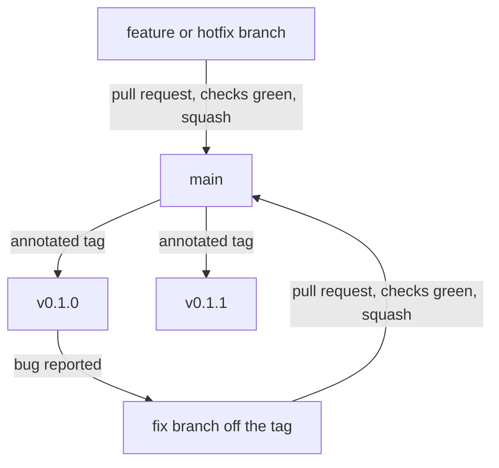

<!-- covers: CMakeLists.txt, .devcontainer/, .github/workflows/ -->
# Branching and releases

Nodens keeps one trunk. Every change integrates into `main` continuously, and a release is an annotated tag on `main` followed by a CI job that publishes it. A single shared main branch, rather than long-lived branches merged into a release line infrequently, is what trunk-based development means.[^orosz]

## Branch roles

| Branch | Purpose | Lifetime | Ends by |
|---|---|---|---|
| `main` | The trunk and the only published lineage. Every commit on it builds. | Permanent | Never |
| `feature/<slug>` | One change, cut from `main`. | Hours to a few days | Squashed into `main` through a pull request |
| `hotfix/<slug>` | A fix for a tag that already shipped, cut from that tag. | Hours | Squashed into `main`, then a patch tag on `main` |
| `release/<version>` | A released line that must stay stable while `main` moves on. | One release cycle | Deleted after the last patch tag |

`dev` is retired at 0.1.0. Keep a `release/<version>` branch only while two versions must be supported at the same time.

## Rules

1. `main` always builds and always passes its checks. Nothing enters it that has not passed CI.[^orosz-health]
2. Every change enters `main` through a pull request and lands as one squashed commit, so the trunk reads one commit per change. Commit and pull request title conventions are in [Committing](COMMITTING.md).
3. A merge that forms a release uses `--no-ff`, so the release boundary stays visible in history.
4. Tags are annotated, named `vMAJOR.MINOR.PATCH`, and created on `main` only.
5. While the major version is 0, a breaking change bumps the minor version: 0.1.0 becomes 0.2.0, never 0.1.1.
6. The tag name and the CMake project version must agree, because the release job refuses to publish when they do not (the version is declared in `CMakeLists.txt`).

## The flow



Every arrow points at `main`. Only tags and short-lived fixes leave it.

## Cutting 0.1.0

Converge the two lines once, then tag.

```bash
git switch main
git merge --no-ff dev -m "Merge dev into main for 0.1.0"
git push origin main
```

Then switch the default branch to `main` in the GitHub repository settings. That is a repository setting, not a git command.

Before tagging, on `main`:

- give `0.1.0` a date in `CHANGELOG.md` and move its sections out of `Unreleased`
- replace the development-status block in `README.md` with the 0.1.0 status and its known limitations
- confirm CI is green on `main`

```bash
git tag -a v0.1.0 -m "Nodens 0.1.0"
git push origin v0.1.0
```

The tag push runs the release job: it builds the tag, checks the version against the project declaration, uploads a source archive, and creates the GitHub Release with generated notes.

After the release is published, retire the old line:

```bash
git branch -d dev
git push origin --delete dev
```

## After 0.1.0

A feature:

```bash
git switch main
git pull --ff-only
git switch -c feature/texture-uploads
# work, commit
git push -u origin feature/texture-uploads
gh pr create --base main --fill
```

Merge it with "Squash and merge", then delete the branch.

A fix for a shipped version:

```bash
git switch -c hotfix/0.1.1 v0.1.0
# fix, commit
git push -u origin hotfix/0.1.1
gh pr create --base main --fill
# squash merge, then
git switch main
git pull --ff-only
git tag -a v0.1.1 -m "Nodens 0.1.1"
git push origin v0.1.1
```

The fix lands on `main` first and is tagged there. When a `release/<version>` branch exists, cherry-pick the commit onto it and tag the patch there instead.

## What CI checks, and when

| Event | Jobs | What it proves |
|---|---|---|
| Pull request into `main` | `format`, `build` for Debug, Release and Profiling | the change compiles in all three configurations, keeps the Vulkan backend, and is formatted |
| Push to `main` | `format`, `build` | the trunk stays releasable |
| Tag `v*` | `build`, `release` | the tagged commit builds and the release is published from it |

The jobs run inside the project's own development image, so CI uses the same compiler and CMake as the dev container (the image is named in each config under `.devcontainer/`). They also assert that the Vulkan backend was compiled in, because a missing Vulkan SDK would otherwise reduce the build to OpenGL without anyone noticing (`CMakeLists.txt` looks for Vulkan with `find_package(Vulkan QUIET)`, so a missing SDK is not an error).

## Why this model

Continuous integration means integrating back to the main branch frequently, through pull requests that each run a build, so a broken change is caught within minutes instead of at release time.[^orosz-ci] In a trunk-based setup that automation is not optional: it is what keeps the trunk healthy enough for everyone to build from it.[^orosz-health] The cost is paid up front, in build tooling and pipeline time, which is what the ladder below spreads out.

## Learning ladder

1. **Trunk and tag.** One branch, release notes written by hand. Teaches that the tag, not the branch, is the release.
2. **Pull request checks.** Build and format gates, required in branch protection. Teaches that the trunk never goes red.
3. **Tests in the gate.** CTest wired in, starting with the job system and the event bus. Teaches that a gate is worth its runtime.
4. **Tag-triggered release.** Archive, generated notes, later hosted docs. Teaches provenance and reproducibility.
5. **Consumer smoke test.** Build `template-nodens-app` against the released tag in CI. Teaches that the API promise is tested from outside.

## Common slips

- A branch that lives for weeks is deferred integration, not a strategy. Either give it a version number and call it a release branch, or split it.
- Tagging from a hotfix branch instead of `main` leaves the fix out of the trunk.
- Editing `CHANGELOG.md` after the tag produces notes that describe a tree that no longer exists.
- Moving the version in `CMakeLists.txt` without tagging, or tagging without moving it, trips the release job on purpose.

## References

[^orosz]: Gergely Orosz, *The Software Engineer's Guidebook: Navigating Senior, Tech Lead, and Staff Engineer Positions at Tech Companies and Startups*, First edition (Amsterdam, Netherlands: The Pragmatic Engineer, 2023), p. 329.

[^orosz-ci]: Orosz, *The Software Engineer's Guidebook*, p. 328.

[^orosz-health]: Orosz, *The Software Engineer's Guidebook*, p. 330.
