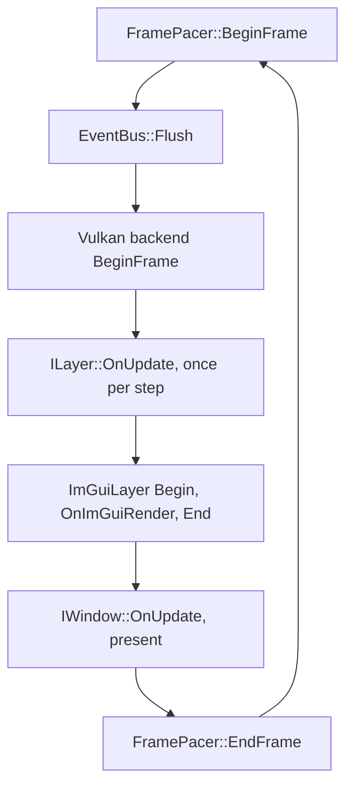

# Application Loop

`Application::Run` services the application every iteration, one pass of the loop. Presentation is one of its participants, not its clock and not its exit condition, which is what lets the same loop run with no window at all.

> [!NOTE]
> **Mental model.** The loop is a time construct. Each pass measures how long the last one took, hands that time to the layers, and only then lets the window present a picture. In fixed mode the loop keeps measured time in an accumulator and pays whole steps out of it at a constant length. Gregory makes the same point from the other side: the loop keeps running when a game is paused, and only the game clock stops.[^gregory-533]

## Problem

An iteration never takes the same time twice. One pass may take 4 ms on an idle machine and 60 ms while a texture loads, and that is a fact about hardware, not about the application.

Movement therefore cannot be counted in iterations. A ball that moves one centimetre per iteration covers 250 cm/s at 4 ms and 17 cm/s at 60 ms, with identical code. The cure is to move by elapsed time instead: `position += velocity * seconds`, where `seconds` is how long the last iteration really took.

Advancing by the real interval is what Nystrom calls a variable or fluid time step, and he states the reason plainly: an update that advances game time by less than it costs to run makes the game slow down.[^nystrom]

That cure leaves three problems, which the rest of this page takes in turn: a single measurement can be enormous, a stall can demand more steps than the machine can afford, and two machines can produce two different results from the same code.

## How it works

`FramePacer` owns the timing and answers one question per iteration: how many steps should run now, and of what length. A step is one advance of the simulation. The loop consumes that answer in a fixed order.



1. **Time.** `FramePacer::BeginFrame` returns an `FFrameTime`: one step, and how many steps this iteration runs.
2. **Events.** `EventBus::Flush` delivers events queued since the last iteration, on the main thread.
3. **Vulkan.** With a Vulkan window, the backend acquires an image and opens the command buffer before layers run, so every consumer records into one buffer.
4. **Update.** `ILayer::OnUpdate` runs once per step, so fixed pacing can run several steps in one iteration, and none at all if no step is due.
5. **ImGui.** The overlay renders between `ImGuiLayer::Begin` and `End` and calls `OnImGuiRender` once per iteration, not once per step.
6. **Present.** `IWindow::OnUpdate` polls the platform and presents the frame, the image the display shows. This step is skipped when there is no window.
7. **Pacing and profiling.** `FramePacer::EndFrame` waits for the next step boundary in fixed mode, then Tracy marks the end of the iteration.

### The four settings

`FPacingConfig` sits on `FApplicationConfig::Pacing`:

| Field | Default | Meaning |
|---|---|---|
| `Pacing` | `EPacing::Variable` | Variable passes the time measured since the last iteration; Fixed runs constant steps |
| `FixedDelta` | 1/60 s | Length of one step in fixed mode |
| `MaxFrameDelta` | 0.25 s | Ceiling on one measured interval, in both modes |
| `MaxStepsPerFrame` | 5 | Ceiling on the steps one iteration may run in fixed mode |

```cpp
Nodens::FApplicationConfig config{};
config.Pacing.Pacing = Nodens::EPacing::Fixed;
config.Pacing.FixedDelta = 1.0f / 60.0f;
```

**Variable** passes the measured time straight through: one measurement becomes one step, of whatever length the machine took. **Fixed** converts measured time into steps of `FixedDelta`, and the accumulator is where the remainder waits.

### The accumulator

In fixed mode the leftover time has nowhere to go unless the loop keeps it. The accumulator is that store: measured milliseconds go in, and each whole `FixedDelta` buys one `OnUpdate` call per layer. Time too short for a step stays in the accumulator and is added to the next iteration. Fiedler names the same variable and the same rule, that time left over at the end of an iteration is passed on to the next one rather than thrown away.[^fiedler]

## What still goes wrong

**A single enormous measurement.** Dragging the window, suspending a laptop or stopping at a breakpoint makes one iteration measure seconds. A layer that trusts the measurement moves seconds' worth in one call, and usually leaves the world or the collision checks behind.

**A burst of catch-up steps.** After a stall, the accumulator owes far more steps than the machine can run in one iteration. Running all of them makes the iteration longer, which owes more steps next time, which lengthens the iteration again.

**Results that depend on speed.** The same simulation integrated in 4 ms slices and in 60 ms slices gives slightly different answers, so a defect seen on a fast machine hides on a slow one.

## Remedies

One remedy per failure, in the same order.

**Clamp the measurement.** To clamp a value is to reduce it to a ceiling when it exceeds one. `MaxFrameDelta` is that ceiling for a measurement, so a stall arrives as an ordinary iteration instead of a jump. Gregory describes this case directly: when the measured time exceeds an upper limit, around a second, assume execution resumed from a breakpoint and set the delta to the target step length, which holds the game to one update for that iteration rather than lurching forward.[^gregory-544]

**Clamp the step count and drop the rest.** `MaxStepsPerFrame` is the most an iteration may run. Above it, the count is clamped and the accumulator is emptied, so the backlog is discarded rather than replayed. This answers the failure Fiedler names, the spiral of death, which is what happens when the simulation cannot keep up with the steps it is being asked to take.[^fiedler]

**Fix the step length.** `EPacing::Fixed` makes every step the same length, so the arithmetic stops depending on the machine. Gregory gives the reason to prefer it: integrators, collision detection and constraint solvers work best when the interval between steps is constant, and a simulation that falls behind should slow down rather than stretch its step to the real frame rate.[^gregory-900]

The two ceilings are an input ceiling and an output ceiling, and they answer different questions:

| Setting | Question | Protects against | Cost when it fires |
|---|---|---|---|
| `MaxFrameDelta` | How large may one measurement be? | One huge step, or an unbounded accumulator | The wall time above the ceiling is never simulated |
| `MaxStepsPerFrame` | How many steps may one iteration run? | A burst of catch-up work | The backlog beyond the ceiling is dropped |

Raising the first alone still leaves the work clamped, because a two second measurement would ask for a hundred steps and the second ceiling would cut it down. Raising the second alone lets that hundred-step request exist.

## A worked case

With `FixedDelta` 10 ms, `MaxFrameDelta` 50 ms and `MaxStepsPerFrame` 3, five iterations look like this:

| Iteration | wall | accumulator in | accumulator / 10 | steps | accumulator out | world advanced |
|---|---|---|---|---|---|---|
| 1 | 12 | 12 | 1.2 | 1 | 2 | 10 ms |
| 2 | 8 | 10 | 1.0 | 1 | 0 | 10 ms |
| 3 | 4 | 4 | 0.4 | 0 | 4 | 0 ms |
| 4 | 3 | 7 | 0.7 | 0 | 7 | 0 ms |
| 5 | 60 | 57 after the clamp | 5.7 | 3, clamped | 0 | 30 ms, 27 ms dropped |

Three rows carry the whole mechanism:

- **Iteration 2** lands on an exact step: 8 ms added to the 2 ms waiting makes one full step and nothing left over.
- **Iteration 3** ran faster than one step, so no update ran at all and an image was still presented. A fixed-step application can present a picture in which the world did not move.
- **Iteration 5** measured 60 ms, the clamp cut it to 50, the accumulated time was worth five steps, the ceiling allowed three, and the remaining 27 ms was discarded rather than stored.

## Choosing

- Leave `Pacing` at `Variable` when the work follows the display: editors, plots, anything the swapchain should pace.
- Choose `Fixed` when the result must be repeatable or must resist timing variance.
- Keep `FixedDelta` between 1/120 s and 1/30 s. Smaller slices cost more updates per second for little accuracy; larger ones make fast motion look stepped.
- Keep `MaxFrameDelta` at about five ordinary iterations. Lower it, to 0.1 s, if a tenth of a second of movement is already visible; raise it only when replaying a long pause is genuinely wanted.
- Keep `MaxStepsPerFrame` at 3 to 5. It sets the longest an ordinary iteration may become, and therefore how heavy a stall it can absorb.

## Rules for a layer

1. `OnUpdate` can run zero or several times per iteration, so a counter inside it counts steps, not iterations.
2. `OnImGuiRender` runs once per iteration, and never without an overlay. Put display logic there and simulation state in `OnUpdate`.
3. Use the `TimeStep` you are given and never keep a clock of your own.
4. Never call `FramePacer::BeginFrame` or `EndFrame`; the loop owns the pacer, and one pacer exists per application.

## Ending the loop

`Application::RequestStop` is the only writer of the running flag. `WindowClose` calls it, and a layer can call it too, which is how a run without a window finishes:

```cpp
Nodens::Application::Get().RequestStop();
```

## Running without a window

Select `EPresentation::Headless` in the config:

```cpp
Nodens::FApplicationConfig config{};
config.Presentation = Nodens::EPresentation::Headless;
```

- The application still owns its task system, layer stack and event bus, and `Run` services all of them.
- `HasWindow()` reports false, and `GetWindow()` terminates the process, so a layer that needs the window or the overlay cannot run.
- Pacing still comes from the pacer, so a headless run is timed like a windowed one.
- `examples/headlesspulse` is the smallest complete case: 600 steps, one stop request, and a `--fixed` flag that shows both modes in the summary it prints.

There is no headless rendering. Without a window there is no swapchain, so a layer that records GPU work has nothing to present.

## Where this sits

The loop lives in `src/Nodens/Core/Application.cppm` and the timing in `src/Nodens/Core/FramePacer.cppm`, exported as `Nodens.FramePacer`. A layer only ever sees its step. See [Layer System](./layer-system.md) for the callbacks and [Architecture Overview](./architecture-overview.md) for what the application owns.

## References

[^gregory-533]: Jason Gregory, *Game Engine Architecture*, Third edition (Boca Raton London New York: CRC Press, Taylor & Francis Group, 2019), p. 533.

[^nystrom]: Robert Nystrom, *Game programming patterns* (s.l.: genever benning, 2014), ch. 9.

[^gregory-900]: Gregory, *Game Engine Architecture*, p. 900.

[^fiedler]: *Fix Your Timestep!* (2004). https://gafferongames.com/post/fix_your_timestep/.

[^gregory-544]: Gregory, *Game Engine Architecture*, p. 544.
