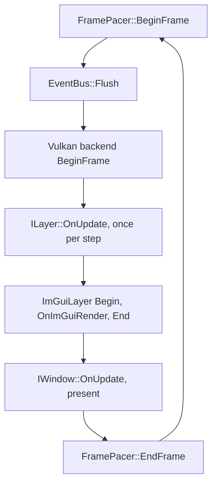

# Application Loop

`Application::Run` services the application every iteration. Presentation is one of its participants, not its clock and not its exit condition, which is what lets the same loop run with no window at all.

> [!NOTE]
> **Mental model.** The loop is a time construct. Each pass asks the pacer what time it is, hands that time to the layers, and only then lets the window present a picture. A window paces and ends the loop in a default build because nothing else does, not because the loop needs a window.

## One iteration



1. **Time.** `FramePacer::BeginFrame` returns an `FFrameTime`: one step, and how many steps this iteration runs.
2. **Events.** `EventBus::Flush` delivers events queued since the last iteration, on the main thread.
3. **Vulkan.** With a Vulkan window, the backend acquires an image and opens the command buffer before layers run, so every consumer records into one buffer.
4. **Update.** `ILayer::OnUpdate` runs once per step, so fixed pacing can run several steps in one iteration.
5. **ImGui.** The overlay renders between `ImGuiLayer::Begin` and `End` and calls `OnImGuiRender` once per iteration, not once per step.
6. **Present.** `IWindow::OnUpdate` polls the platform and presents the frame. It is skipped when there is no window.
7. **Pacing and profiling.** `FramePacer::EndFrame` waits for the next step boundary in fixed mode, then the Tracy frame is marked.

## Pacing

`FPacingConfig` sits on `FApplicationConfig::Pacing` and has four fields:

| Field | Default | Meaning |
|---|---|---|
| `Pacing` | `EPacing::Variable` | Variable passes the measured frame time; Fixed runs constant steps |
| `FixedDelta` | 1/60 s | Length of one step in fixed mode |
| `MaxFrameDelta` | 0.25 s | Cap on one frame of wall time, in both modes |
| `MaxStepsPerFrame` | 5 | Catch-up limit in fixed mode; the rest of a backlog is dropped |

- **Variable** suits work that follows the display: editors, plots, anything the swapchain should pace.
- **Fixed** suits simulation whose result must not depend on frame rate. Several steps can run in one iteration, the count is capped, and `EndFrame` sleeps so the loop does not spin.

The clamp applies before either mode, so a dragged window or a suspended process arrives as `MaxFrameDelta` instead of one long step.

## Ending the loop

`Application::RequestStop` is the only writer of the running flag. `WindowClose` calls it, and a layer can call it too, which is how a run without a window finishes:

```cpp
Nodens::Application::Get().RequestStop();
```

## Running without a window

Select `EPresentation::Headless` in the config:

```cpp
Nodens::FApplicationConfig config{};
config.Presentation = Nodens::EPresentation::Headless;
```

- The application still owns its task system, layer stack and event bus, and `Run` services all of them.
- `HasWindow()` reports false, and `GetWindow()` terminates the process, so GUI layers are never constructed.
- Pacing still comes from the pacer, so a headless run is timed like a windowed one.
- `examples/headlesspulse` is the smallest complete case: 600 steps, one stop request, and a `--fixed` flag for paced timing.

There is no headless rendering. Without a window there is no swapchain, so a layer that records GPU work has nothing to present.

## Where this sits

The loop lives in `src/Nodens/Core/Application.cppm` and the timing in `src/Nodens/Core/FramePacer.cppm`, exported as `Nodens.FramePacer`. A layer only ever sees its step. See [Layer System](./layer-system.md) for the callbacks and [Architecture Overview](./architecture-overview.md) for what the application owns.
