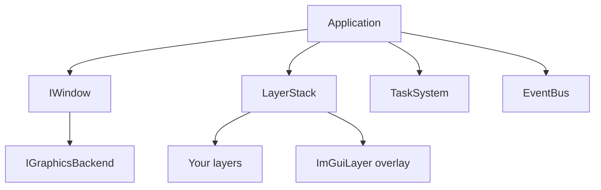

# Architecture Overview

How Nodens fits together, from the object that owns everything down to the platform underneath.

> [!NOTE]
> **Mental model.** One object, `Application`, owns everything and runs one loop. Each pass of the loop is a **frame**. Your code lives in layers that the loop calls, and the platform (GLFW, Vulkan, OpenGL) hides behind two small interfaces, so nothing above them knows which backend is running.
>
> This page answers five questions, in order:
>
> 1. **Who owns what?** [Ownership](#ownership)
> 2. **What happens in a frame?** [The frame](#the-frame)
> 3. **How do messages travel?** [Messages](#messages)
> 4. **Which thread does what?** [Threads](#threads)
> 5. **How is the platform hidden?** [The platform](#the-platform)

## Ownership

`Application` is a singleton (`Application::Get()`); creating a second one terminates the process. It owns its subsystems, and they own the rest:

The `LayerStack` owns every layer and deletes it when the application ends. When `EnableGUI` is true, `Application` itself creates the `ImGuiLayer` and pushes it as an overlay.

You write a single `import nodens;`. That umbrella module re-exports everything public:

| Group | Modules | Role |
|---|---|---|
| Core | `Nodens.Application`, `Nodens.Log`, `Nodens.TimeStep` | Lifecycle, logging, frame delta time |
| Layers | `Nodens.Layer`, `Nodens.LayerStack` | `ILayer` and the ordered stack that holds layers |
| Events | `Nodens.Event`, `Nodens.EventBus`, `Nodens.InputEvents` | Plain-data events, the bus, window and input events |
| Concurrency | `Nodens.TaskSystem` | Thread pool with `std::future` results |
| Input | `Nodens.Input`, `Nodens.KeyCodes`, `Nodens.MouseButtonCodes` | Polling keyboard and mouse state |
| ImGui | `Nodens.ImGuiLayer`, `Nodens.ImGuiRenderer`, `Nodens.DefaultTheme` | ImGui lifecycle, renderer abstraction, themes |
| Rendering | `Nodens.Window`, `Nodens.GraphicsBackend` | `IWindow`, `IGraphicsBackend`, `EGraphicsAPI` |

The platform classes (`GlfwWindow`, `OpenGLBackend`, `VulkanBackend` and the two ImGui renderers) are not in the umbrella module. Application code never names them.

## The frame

`Application::Run()` repeats the same steps until a `WindowClose` event ends it:

1. **Time.** Measure the `TimeStep`, the time since the previous frame.
2. **Flush the event bus.** Deliver events queued since the last frame, on the main thread.
3. **Begin the Vulkan frame.** With Vulkan, acquire a swapchain image and open the command buffer, so everything that records GPU work this frame, including ImGui, appends to one buffer.
4. **Update.** Call `OnUpdate(ts)` on every layer, front to back.
5. **Draw ImGui.** If the GUI is enabled, call `OnImGuiRender(ts)` on every layer between `ImGuiLayer::Begin()` and `End()`.
6. **Poll and present.** The window polls GLFW, which fires input callbacks, and presents the frame.
7. **Mark the frame** for the Tracy profiler.

[Layer System](./layer-system.md) describes the callbacks each layer receives in steps 4 and 5.

## Messages

Nodens has two independent ways to send a message, and the choice depends on whether order matters. Both are covered in [Event System](./event-system.md).

- **Input events** (keys, mouse, window) come from GLFW in step 6. `Application` first reacts to `WindowClose` itself, then offers the event to each layer **back to front**, until one handles it. Overlays sit at the back, so the `ImGuiLayer` sees input first and can keep it while ImGui wants it (when `ShouldImGuiBlockInputs` is true).
- **Everything else** goes through the `EventBus`. `Dispatch` calls subscribers immediately on the calling thread. `QueueEvent` stores the event, and the `Flush` in step 2 delivers it on the main thread. That is how a worker thread reports back safely.

## Threads

| Thread | What runs there |
|---|---|
| **Main thread** | The window, GLFW polling, rendering, ImGui, layer callbacks, input dispatch and `EventBus::Flush` |
| **Worker threads** | `TaskSystem` tasks. The pool has `hardware_concurrency - 1` workers, named `Worker 0`, `Worker 1`, and so on in Tracy |

- `TaskSystem::Submit` and `EventBus::QueueEvent` are safe from any thread. The PlanetaryScan example does both: the layer submits a task, and the task queues a result event from the worker.
- Window, rendering, ImGui and layer-stack calls belong to the main thread.
- A worker reports back through a queued event or a `std::future` the main thread polls. [Concurrency and TaskSystem](./concurrency-and-tasksystem.md) has the reasoning.

## The platform

Two small interfaces separate the framework from the platform:

- **`IWindow`** creates and polls the window, reports its size, and exposes the native handle and the graphics backend. `IWindow::Create(config)` returns the concrete window, currently `GlfwWindow`.
- **`IGraphicsBackend`** has `Init()` and `Present()`. Each backend implements it.

You choose the API per application with `FApplicationConfig::GraphicsAPI`:

| `EGraphicsAPI` | Window | Backend | ImGui renderer |
|---|---|---|---|
| `Vulkan` (default) | GLFW window with no client API | `VulkanBackend` | `VulkanImGuiRenderer` |
| `OpenGL` | GLFW window with an OpenGL context | `OpenGLBackend` | `OpenGLImGuiRenderer` |
| `NoAPI` | GLFW window with no client API | none | none, so `EnableGUI = true` is a fatal error at startup |

The backends are also chosen at **build time** with `ND_ENABLE_OPENGL` and `ND_ENABLE_VULKAN`, both on by default. Selecting a backend that was not compiled in is a fatal error at startup ("Nodens was built without Vulkan support!"). [Building and Toolchain](./building-and-toolchain.md) explains what happens when the Vulkan SDK is missing at configure time.

**The Vulkan backend is shared.** `VulkanBackend` owns the instance, surface, device, queues, swapchain, command buffers and frame synchronization. Consumers borrow these handles and never destroy them. The ImGui renderer is one consumer; an external renderer can be another, and because the frame is opened before the layers run, they all append to the same command buffer.

**Adding a backend** touches four places: implement `IGraphicsBackend`, implement `ImGuiRenderer`, add an `EGraphicsAPI` value and teach `GlfwWindow` to create its window and backend, and teach `Application` to pick the matching ImGui renderer.

## See Also

- [Layer System](./layer-system.md): the layer lifecycle.
- [Event System](./event-system.md): event types, dispatching and the bus.
- [Concurrency and TaskSystem](./concurrency-and-tasksystem.md): the thread pool.
- [Using ImGui and ImPlot](./using-imgui-and-implot.md): how the ImGui layer is set up.
