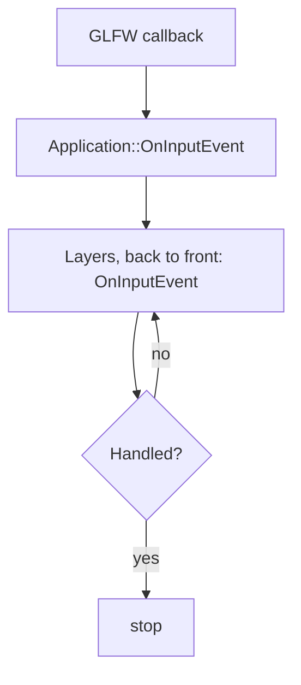
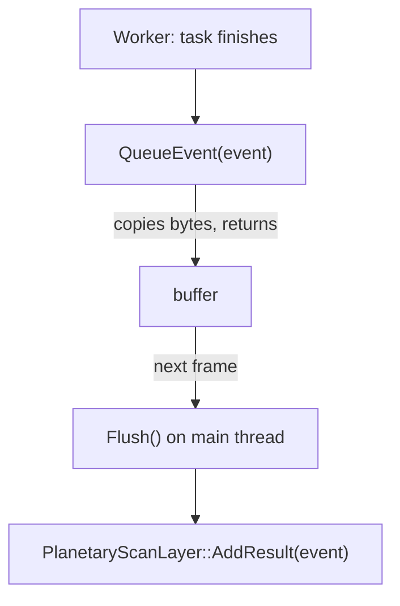

# Event System

How messages move through Nodens: input that reaches your layers in order, and everything else that travels on a bus.

> [!NOTE]
> **Mental model.** There are two mailboxes. Input from the window is handed to the layers one at a time, top layer first, and stops at the first layer that handles it. Everything else goes on a bus: listeners subscribe to an event type, and the sender never knows who, if anyone, is listening.
>
> This page builds that picture in four steps:
>
> 1. **What an event is.** [Events are plain data](#events-are-plain-data)
> 2. **The ordered mailbox.** [Input events](#input-events)
> 3. **The open mailbox.** [The EventBus](#the-eventbus)
> 4. **Printing events.** [Logging an event](#logging-an-event)

## Events are plain data

Both mailboxes carry the same kind of thing: a small struct with data and a name, and nothing else.

```cpp
struct PlanetaryScanResultEvent
{
    static constexpr std::string_view Name = "PlanetaryScanResult";
    int   m_ID{};
    float m_Distance{};
    float m_AtmosphereDensity{};
    float m_CalculationTime{};
};

static_assert(Nodens::Event<PlanetaryScanResultEvent>);
```

The `Event` concept (`src/Nodens/Events/Event.cppm`) asks for exactly that shape: standard-layout, trivially copyable, with a static `Name`. There is no base class, no virtual function and no RTTI. Because an event can be copied byte for byte, the bus queues it by copying its bytes into a per-type buffer, with no per-event object and no handler lookup.

Each event type gets an integer ID the first time it is used (`GetEventTypeId<TEvent>()`). The value depends on first-use order, so never store or hard-code one.

## Input events

Input events come from the window and form a closed set, defined in `src/Nodens/Events/InputEvents.cppm`:

- **Keyboard:** `KeyPressed`, `KeyReleased`, `KeyTyped`
- **Mouse:** `MouseMoved`, `MouseScrolled`, `MouseButtonPressed`, `MouseButtonReleased`
- **Window:** `WindowResize`, `WindowClose`

`Nodens::InputEvent` is a `std::variant` of these. The framework carries it inside a `RoutedInputEvent`, which adds one flag, `Handled`.

### How an event reaches your layer

1. A GLFW callback in `GlfwWindow.cpp` builds a `RoutedInputEvent` and passes it to `Application::OnInputEvent`.
2. `Application` handles `WindowClose` itself (it stops the main loop), then calls `ILayer::OnInputEvent` on each layer **back to front**.
3. Iteration stops as soon as a layer sets `Handled = true`.

Back to front means overlays go first, so the `ImGuiLayer` can claim input before your layers see it.



### Handling an event in a layer

`InputEventDispatcher` runs your handler only when the event is the type you asked for. Return `true` to consume it.

```cpp
void YourLayer::OnInputEvent(Nodens::RoutedInputEvent& e)
{
    Nodens::InputEventDispatcher dispatcher(e);

    dispatcher.Dispatch<Nodens::InputEvents::KeyPressed>(
        [this](Nodens::InputEvents::KeyPressed& event)
        {
            Nodens::CoreLogger().info("Key {} (repeat {})", event.KeyCode, event.RepeatCount);
            return true; // consume the event
        });
}
```

`IsMouseEvent(e)` and `IsKeyboardEvent(e)` classify an event by its type, and `GetInputEventName(e)` returns its name.

### Why clicking a button does not move the camera

`ImGuiLayer::OnInputEvent` marks an event handled when ImGui wants it:

```cpp
e.Handled |= IsMouseEvent(e.Event)    && io.WantCaptureMouse;
e.Handled |= IsKeyboardEvent(e.Event) && io.WantCaptureKeyboard;
```

Because the `ImGuiLayer` is an overlay it runs first, so those events never reach your layers. Turn this off with `ShouldImGuiBlockInputs = false` in the application specification, or at runtime with `ImGuiLayer::BlockEvents`.

## The EventBus

Every other message travels through the `EventBus`, which the `Application` owns: `Application::Get().GetEventBus()`.

```cpp
SubscriptionID Subscribe<TEvent>(handler);   // listen for one event type
void           Unsubscribe(id);

void Dispatch<TEvent>(TEvent& event);        // deliver now, on this thread
void QueueEvent<TEvent>(TEvent event);       // store; deliver at the next Flush
void Flush();                                // the application calls this once per frame
```

| Method | Call from | Behavior |
|---|---|---|
| `Subscribe<T>(handler)` | any thread | Registers a typed handler and returns a `SubscriptionID`. |
| `Unsubscribe(id)` | any thread | Removes a subscription. |
| `Dispatch<T>(event)` | main thread | Calls every subscriber immediately, in subscription order. |
| `QueueEvent<T>(event)` | any thread | Copies the event into a buffer and returns at once. |
| `Flush()` | main thread | Delivers everything queued since the last flush. |

**Which to use.** `Dispatch` suits events produced and consumed on the main thread. `QueueEvent` suits events produced on a `TaskSystem` worker that must be handled on the main thread, because `Flush` always runs there, once per frame before the layers update. A handler may safely call `Subscribe` or `Unsubscribe`.

### Example: the PlanetaryScan app

`examples/planetaryscan` uses the whole path. The layer subscribes in `OnAttach`:

```cpp
void PlanetaryScanLayer::OnAttach()
{
    Nodens::Application::Get().GetEventBus().Subscribe<PlanetaryScanResultEvent>(
        [this](PlanetaryScanResultEvent& e) { AddResult(e); });
}
```

A task running on a worker publishes its result:

```cpp
Nodens::Application::Get().GetEventBus().QueueEvent<PlanetaryScanResultEvent>(e);
```

and the next `Flush` calls `AddResult` on the main thread. Store the `SubscriptionID` that `Subscribe` returned and pass it to `Unsubscribe` in `OnDetach` to release the subscription.



## Logging an event

Events work without a formatter; you need one only to log an event or pass it to `std::format`. It lives outside the struct, as a `std::formatter` specialization, so the event stays pure data. Put it in the same module, right after the struct:

```cpp
template <>
struct std::formatter<PlanetaryScanResultEvent> : std::formatter<std::string_view>
{
    template <typename FormatContext>
    auto format(const PlanetaryScanResultEvent& e, FormatContext& ctx) const
    {
        return std::format_to(ctx.out(),
                              "PlanetaryScanResult(id={}, distance={:.2f} ly, density={:.3f})",
                              e.m_ID, e.m_Distance, e.m_AtmosphereDensity);
    }
};
```

- Specialize in namespace `std`, the only place the language allows it; never add a `format` member to the event.
- Derive from `std::formatter<std::string_view>` so you inherit `parse()` and never write a format-spec parser.
- Write with `std::format_to(ctx.out(), ...)` and return its iterator. The spec stays empty (`{}`): a width such as `{:>12}` is parsed but not applied.

Then the event formats anywhere, including Nodens' loggers, which are built with `SPDLOG_USE_STD_FORMAT` and so use standard formatters directly:

```cpp
Nodens::ClientLogger().info("scan complete: {}", e);
```

The PlanetaryScan example defines a formatter with this shape and adds a latency field to its output.

## See Also

- [Layer System](./layer-system.md): how input reaches layers.
- [Concurrency and TaskSystem](./concurrency-and-tasksystem.md): the workers that feed `QueueEvent`.
- [Examples Guide](./examples-guide.md): the PlanetaryScan example in full.
