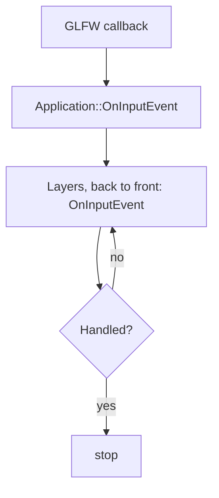
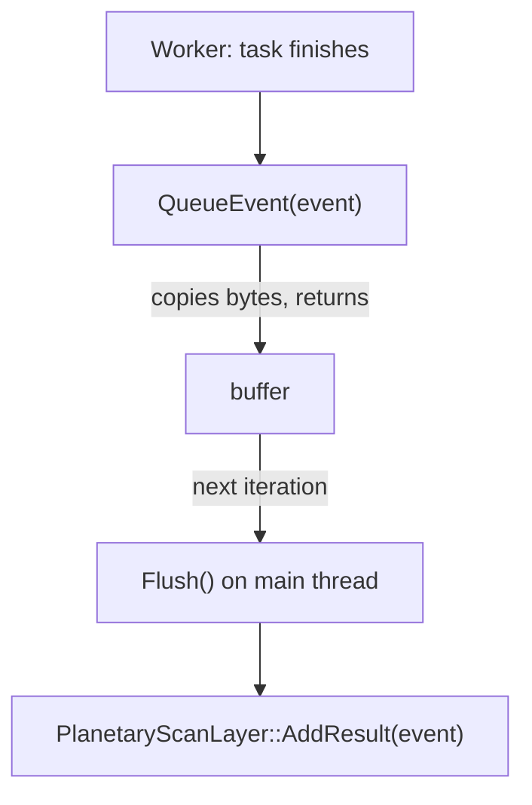

# Event System

How messages move through Nodens: input that reaches your layers in order, and everything else that travels on a bus.

> [!NOTE]
> **Mental model.** There are two mailboxes. Input from the window is handed to the layers one at a time, from the top of the stack down, and stops at the first layer that handles it. Everything else goes on a bus: a listener subscribes to an event type, and the sender never knows who, if anyone, is listening.

## Problem

Two kinds of message need to travel, and they want opposite things.

A key press happens once, and something must decide who handles it: the UI, or the layer below. A result produced on a worker thread must reach the main thread without either side racing the other. One mechanism cannot serve both well. A single callback chain gives no way to broadcast, and a single broadcast bus loses the ordering that "who handles this key first" depends on.

Nodens therefore has two paths over one data shape, and this page covers both.

## How it works

### Events are plain data

Both mailboxes carry the same kind of thing: a small struct with data and a name, and nothing else.

```cpp
struct PlanetaryScanResultEvent
{
    static constexpr std::string_view Name = "PlanetaryScanResult";
    int   m_ID{};
    float m_Distance{};
    float m_AtmosphereDensity{};
    float m_CalculationTime{};
};

static_assert(Nodens::Event<PlanetaryScanResultEvent>);
```

The `Event` concept (`src/Nodens/Events/Event.cppm`) asks for exactly that shape: standard-layout, trivially copyable, with a static `Name`. There is no base class, no virtual function and no RTTI. Because an event can be copied byte for byte, the bus queues it by copying its bytes into a per-type buffer, with no per-event object and no handler lookup.

Each event type gets an integer ID the first time it is used, read with `GetEventTypeId<TEvent>()`. The value depends on first-use order, so never store or hard-code one.

### Input takes a fixed path

Input events come from the window and form a closed set, defined in `src/Nodens/Events/InputEvents.cppm`:

- **Keyboard:** `KeyPressed`, `KeyReleased`, `KeyTyped`
- **Mouse:** `MouseMoved`, `MouseScrolled`, `MouseButtonPressed`, `MouseButtonReleased`
- **Window:** `WindowResize`, `WindowClose`

`Nodens::InputEvent` is a `std::variant` of these. The framework carries it inside a `RoutedInputEvent`, which adds one flag, `Handled`.



1. A GLFW callback in `GlfwWindow.cpp` builds a `RoutedInputEvent` and passes it to `Application::OnInputEvent`.
2. `Application` handles `WindowClose` itself (it requests the main loop to stop), then calls `ILayer::OnInputEvent` on each layer **back to front**.
3. Iteration stops as soon as a layer sets `Handled = true`.

Back to front means overlays go first, so the `ImGuiLayer` can claim input before your layers see it. `InputEventDispatcher` runs your handler only for the type you ask for, and the handler returns `true` to consume the event:

```cpp
void YourLayer::OnInputEvent(Nodens::RoutedInputEvent& e)
{
    Nodens::InputEventDispatcher dispatcher(e);

    dispatcher.Dispatch<Nodens::InputEvents::KeyPressed>(
        [this](Nodens::InputEvents::KeyPressed& event)
        {
            Nodens::CoreLogger().info("Key {} (repeat {})", event.KeyCode, event.RepeatCount);
            return true; // consume the event
        });
}
```

`IsMouseEvent(e)` and `IsKeyboardEvent(e)` classify an event by its type, and `GetInputEventName(e)` returns its name.

### The bus is open

Every other message travels through the `EventBus`, which the `Application` owns: `Application::Get().GetEventBus()`.

```cpp
SubscriptionID Subscribe<TEvent>(handler);   // listen for one event type
void           Unsubscribe(id);

void Dispatch<TEvent>(TEvent& event);        // deliver now, on this thread
void QueueEvent<TEvent>(TEvent event);       // store; deliver at the next Flush
void Flush();                                // the application calls this once per iteration
```

| Method | Call from | Behavior |
|---|---|---|
| `Subscribe<T>(handler)` | any thread | Registers a typed handler and returns a `SubscriptionID`. |
| `Unsubscribe(id)` | any thread | Removes a subscription. |
| `Dispatch<T>(event)` | main thread | Calls every subscriber immediately, in subscription order. |
| `QueueEvent<T>(event)` | any thread | Copies the event into a buffer and returns at once. |
| `Flush()` | main thread | Delivers everything queued since the last flush. |

A subscription is the bus's record of one handler for one event type. The application flushes the queue once per iteration, before the layers update, which is what makes a queued event a safe way for a worker to hand work back to the main thread.

### Printing an event

Events work without a formatter; you need one only to log an event or pass it to `std::format`. It lives outside the struct, as a `std::formatter` specialization, so the event stays pure data:

```cpp
template <>
struct std::formatter<PlanetaryScanResultEvent> : std::formatter<std::string_view>
{
    template <typename FormatContext>
    auto format(const PlanetaryScanResultEvent& e, FormatContext& ctx) const
    {
        return std::format_to(ctx.out(),
                              "PlanetaryScanResult(id={}, distance={:.2f} ly, density={:.3f})",
                              e.m_ID, e.m_Distance, e.m_AtmosphereDensity);
    }
};
```

Specialize in namespace `std`, the only place the language allows it, and never add a `format` member to the event. Derive from `std::formatter<std::string_view>` so you inherit `parse()` and never write a format-spec parser.

## What still goes wrong

**A stored type ID.** The ID depends on first-use order, so a value written into a file or a constant is wrong on the next run.

**A handler run on a worker.** `Dispatch` calls subscribers on the calling thread. Called from a task, the handler runs on that worker, and any UI or window call inside it breaks.

**A subscriber outliving its layer.** A handler that captures `this` keeps running after the layer is gone unless the subscription is released.

**Expecting immediate delivery from a queued event.** `QueueEvent` returns at once and delivers at the next flush, so a handler that must run inside the same iteration needs `Dispatch`.

**Input looked for on the bus.** Keyboard, mouse and window events never travel there.

**Clicks that do nothing.** The `ImGuiLayer` marks an event handled when ImGui wants it:

```cpp
e.Handled |= IsMouseEvent(e.Event)    && io.WantCaptureMouse;
e.Handled |= IsKeyboardEvent(e.Event) && io.WantCaptureKeyboard;
```

Because the overlay runs first, those events never reach your layers.

## Remedies

**Use the template helpers, never a stored ID.** `Subscribe<T>`, `Dispatch<T>`, `QueueEvent<T>` and `GetEventTypeId<T>` all derive the ID from the type.

**Queue from a worker, dispatch on the main thread.** A worker calls `QueueEvent`; the framework calls `Flush` on the main thread. Set `Handled` only from a handler that runs there.

**Keep the `SubscriptionID` and unsubscribe in `OnDetach`.** That releases the handler before the layer is deleted.

**Treat a queued event as next-iteration work.** The flush happens before the layers update, so the handler runs once per iteration, on the main thread, in the order it was queued.

**Handle input in `ILayer::OnInputEvent`.** That is the only path for keys, mouse and window events.

**Unblock input deliberately.** Set `ShouldImGuiBlockInputs = false` in the application specification, or call `ImGuiLayer::BlockEvents` at runtime, when a layer must see input that ImGui captures. The alternative is to check `WantCaptureMouse` in the layer before acting.

## A worked case

`examples/planetaryscan` uses the whole bus path. The layer subscribes in `OnAttach`:

```cpp
void PlanetaryScanLayer::OnAttach()
{
    Nodens::Application::Get().GetEventBus().Subscribe<PlanetaryScanResultEvent>(
        [this](PlanetaryScanResultEvent& e) { AddResult(e); });
}
```

A task running on a worker publishes its result:

```cpp
Nodens::Application::Get().GetEventBus().QueueEvent<PlanetaryScanResultEvent>(e);
```



| Step | Thread | What happens |
|---|---|---|
| 1 | main | The layer subscribes and keeps the `SubscriptionID` |
| 2 | main | A button calls `TaskSystem::Submit` |
| 3 | worker | The task computes and calls `QueueEvent` |
| 4 | main | The next iteration flushes and calls `AddResult` |
| 5 | main | `OnImGuiRender` draws the results collected so far |

The handler runs once per iteration, never inside the worker, and the queue is what carries the result across the thread boundary.

## Choosing

- **`Dispatch` or `QueueEvent`?** Use `Dispatch` when producer and consumer are already on the main thread and the handler must run now. Use `QueueEvent` when the producer is a worker, or when the handler must wait for a safe point in the iteration.
- **Event or future?** Use the bus when several tasks report to one listener, and a `std::future` when one task has one consumer. [Concurrency and TaskSystem](./concurrency-and-tasksystem.md) compares them.
- **A formatter or plain fields?** Add one when the event is logged or formatted; leave it out otherwise, since the event type stays useful without it.

## Rules

1. An event is plain data: no base class, no virtual functions, no members that manage resources.
2. Never store an event type ID.
3. Unsubscribe in `OnDetach`.
4. Flush belongs to the loop; a layer never calls it.
5. Input arrives through `OnInputEvent`, everything else through the bus.

## See Also

- [Layer System](./layer-system.md): how input reaches layers, and in which order.
- [Concurrency and TaskSystem](./concurrency-and-tasksystem.md): the workers that feed `QueueEvent`.
- [Examples Guide](./examples-guide.md): the PlanetaryScan example in full.
