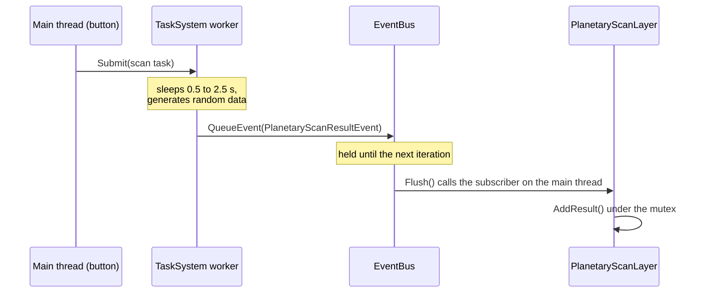

# Examples Guide

Three small programs in the Nodens repository, each the smallest complete application for one idea. Read them after the concept pages, or alongside them. The README has a [short overview](../../README.md#example-applications).

> [!NOTE]
> **Mental model.** Each example is an application class that pushes a single layer. Learn that shape once, then read what the layer does.

| Example | The idea it shows | Read first |
|---|---|---|
| [`circularwave3d`](#circularwave3d) | **Drawing:** layer state plus ImPlot and ImPlot3D | [Using ImGui and ImPlot](./using-imgui-and-implot.md) |
| [`planetaryscan`](#planetaryscan) | **Concurrency:** tasks on workers, results back through the event bus | [Concurrency and TaskSystem](./concurrency-and-tasksystem.md), [Event System](./event-system.md) |
| [`headlesspulse`](#headlesspulse) | **Lifecycle:** a loop with no window, ended by a layer | [Layer System](./layer-system.md) |

## Problem

The API reference lists every class and every function, which teaches the parts and not how they fit. What a newcomer lacks is a working arrangement: which object owns what, which callback does which job, and how the pieces hand work to each other.

Three examples answer that, one idea each, small enough to read whole. The difficulty moves elsewhere:

- An example that answers a different question costs the reading time and teaches habits that must then be unlearned.
- An example copied as a starting point carries whatever the example needed and the application does not.
- An example read before its concept page shows the code without the rule behind it.

This page maps each example to the question it answers, and reads one of them end to end.

## How it works

### The common shape

The two windowed examples have the same skeleton:

- an application file with `main()` and a `Nodens::Application` subclass that pushes the layer, and
- a layer module, its interface in a `.cppm` file and its implementation in a `.cpp` file.

```cpp
class CircularWave3DApp : public Nodens::Application
{
public:
    static inline const Nodens::FApplicationConfig appConfig = {
        .Name = "[NodensApp Example] CircularWave3D",
        .WindowWidth = 800,
        .WindowHeight = 600,
        .Presentation = Nodens::EPresentation::WindowImGUI,
    };

    CircularWave3DApp() : Application(appConfig)
    {
        PushLayer(new CircularWave3DLayer());
    }
};
```

`headlesspulse` departs from the skeleton in one way: it has no layer module and no window.

### circularwave3d

**Answers:** how does a layer hold state, update it per step, and draw it as a 2D and a 3D plot?

It opens an 800 by 600 window with two panels. **ImPlot Example** draws the sine and cosine components of a circular wave as two lines, and **ImPlot3D Example** draws the same wave as one rotatable 3D curve with the axes `t`, `x` and `y`.

The layer owns three arrays of 1000 floats: time `t`, and the wave's `xs` and `ys`:

- **Constructor:** fills the arrays with `xs = sin(f * t)` and `ys = cos(f * t)`, at a frequency `f` of 5π.
- **`OnUpdate`:** advances every `t` by a small increment and recomputes `xs` and `ys`, so the curve scrolls. The increment is `speed * ts`, which keeps the speed the same at any rate.
- **`OnImGuiRender`:** opens two ImGui windows, one with `ImPlot::BeginPlot` and a `PlotLine` per component, one with `ImPlot3D::BeginPlot` and a single `PlotLine` over `t`, `xs` and `ys`. Both use `AutoFit` axes, so they follow the moving data.

**Key files:** [app](../../examples/circularwave3d/CircularWave3DApp.cpp), [layer interface](../../examples/circularwave3d/CircularWave3DLayer.cppm), [layer implementation](../../examples/circularwave3d/CircularWave3DLayer.cpp), [CMake](../../examples/circularwave3d/CMakeLists.txt), which registers the interface as a `CXX_MODULES` file set.

### planetaryscan

**Answers:** how does one layer submit work to the task system, get results back from workers, and keep the data safe while drawing?

It opens an 800 by 600 window with two panels. **Deep Space Analytics** holds two buttons, **Launch Single Probe** and **Launch Swarm (20 Probes)**, and a scatter plot of each finished scan's distance against atmosphere density. **Performance Monitor** draws a bar per recent task, its height the task's duration.

The whole flow is the worked case below.

**Key files:** [app](../../examples/planetaryscan/PlanetaryScanApp.cpp), [event, formatter and layer interface](../../examples/planetaryscan/PlanetaryScanLayer.cppm), [subscribing, submitting, storing and drawing](../../examples/planetaryscan/PlanetaryScanLayer.cpp).

### headlesspulse

**Answers:** what does an application do when there is no window at all?

It is one file and no layer module. `main()` sets `EPresentation::Headless`, pushes a layer that counts steps, and calls `Run()`.

- **No window:** the application creates no platform window and no overlay, so `GetWindow()` would terminate the process and `HasWindow()` reports the truth instead.
- **Time still flows:** `Application::Run` takes each step from `Nodens.FramePacer`, which is why the loop needs no window to pace it.
- **Self-termination:** the layer, not a window close, requests the stop, which lets the run finish on its own after 600 steps.
- **Output:** every hundredth step prints the count, and the run ends with one summary line of mode, steps, simulated seconds, wall seconds and seconds per step. `--variable` and `--fixed` show what pacing changes: the same 600 steps, about a millisecond of simulated time in the first and 10 seconds in the second.

**Key file:** [the whole example](../../examples/headlesspulse/HeadlessPulseApp.cpp).

## What still goes wrong

**An example used as a template.** The examples exist to be read, and they carry what their own idea needed. The [application template](https://github.com/eldritch-codex/template-nodens-app) is the starting point for a new project.

**An example read before its concept page.** The code then shows the arrangement without the rule, and the first change made to it breaks the arrangement.

**Expecting production code.** Each example is the smallest program that shows one idea. Error handling, configuration and structure are deliberately absent.

**Running an example that was not built.** The examples are part of the Nodens build, not a separate project, so only a build with `ND_BUILD_EXAMPLES` produces them.

**Copying a config whole.** The examples set a name, a size and a presentation state; a real application usually needs `VSync`, `GraphicsAPI` and `Pacing` set deliberately, and the defaults may not suit it.

## Remedies

**Start from the template, read the examples.** Create a project from the template, then read the example whose idea the application needs.

**Read the concept page first, the example second.** The page states the rule, and the example shows one arrangement that follows it.

**Take the shape, not the code.** The application class, the one layer, and the callback split are worth copying. The rest belongs to the example's idea.

**Build before you run.** Configure with `ND_BUILD_EXAMPLES` on, which is the default when Nodens is the top-level project.

**Read every config field the example does not set.** The defaults are documented in [Architecture Overview](./architecture-overview.md) and [Application Loop](./application-loop.md).

## A worked case: one probe

`planetaryscan` runs the whole path from a button to a plotted point.



1. **The event.** `PlanetaryScanResultEvent` is a plain struct holding an ID, a distance, an atmosphere density and a calculation time, plus the `Name` string every event needs. A `std::formatter` specialization next to it makes the event printable. [Event System](./event-system.md) covers the rules events follow.
2. **Subscribing.** In `OnAttach` the layer calls `Application::Get().GetEventBus().Subscribe<PlanetaryScanResultEvent>(...)`, with a lambda that calls `AddResult`.
3. **Launching a task.** A button press calls `LaunchScanJob`, which uses `Application::Get().GetTaskSystem().Submit(...)`. The task sleeps for a random 0.5 to 2.5 seconds to imitate a slow computation, generates the data, measures its own duration and fills in an event.
4. **Reporting back.** The task ends with `GetEventBus().QueueEvent<PlanetaryScanResultEvent>(e)`. That call is safe from a worker and only stores the event.
5. **Delivery.** At the start of the next iteration, `Application::Run` calls `EventBus::Flush()`, which invokes the layer's subscriber **on the main thread**.
6. **Storing.** `AddResult` takes the layer's mutex, appends the distance, density and latency, and trims the latency history to the last 100 entries so memory stays bounded.
7. **Drawing.** `OnImGuiRender` locks the same mutex while it plots, so the lists cannot change mid-draw.

### What to watch

- Press **Launch Swarm (20 Probes)**. With fewer idle workers than probes, the surplus waits in the queue and results arrive in waves as workers free up. A `Profiling` build shows the backlog draining in the **Job Queue Size** plot; see [Profiling with Tracy](./profiling-with-tracy.md).
- Read the **Performance Monitor** bars: each is one task's duration, which is its random sleep, so heights vary between about 0.5 and 2.5 seconds.

## Choosing

| The question | The example |
|---|---|
| How does a layer hold state and draw it, in 2D and 3D? | `circularwave3d` |
| How does work leave the main thread and come back safely? | `planetaryscan` |
| What does an application do without a window? | `headlesspulse` |
| How do I start a new project? | [Getting Started](./getting-started.md), and the application template |

## Running the examples

The examples are built by default when Nodens is the top-level project, because `ND_BUILD_EXAMPLES` is `ON` there. From the repository root, inside the dev container:

```shell
cmake -S . -B build -DCMAKE_BUILD_TYPE=Debug
cmake --build build

# Run an example
./build/examples/circularwave3d/example-circularwave3d
./build/examples/planetaryscan/example-planetaryscan
./build/examples/headlesspulse/example-headlesspulse
```

To build one alone, name its target, for example `cmake --build build --target example-planetaryscan`. To profile one, configure with `-DCMAKE_BUILD_TYPE=Profiling` and connect the profiler; see [Profiling with Tracy](./profiling-with-tracy.md).

## Rules

1. Read the example, do not copy it as a project.
2. Read the concept page first.
3. Expect the smallest program that shows the idea, not production code.
4. Build with `ND_BUILD_EXAMPLES` on before expecting a binary.

## See Also

- [Architecture Overview](./architecture-overview.md): what the application owns.
- [Layer System](./layer-system.md): the callbacks each example implements.
- [Creating a Custom Layer](./creating-a-custom-layer.md): your own layer, step by step.
