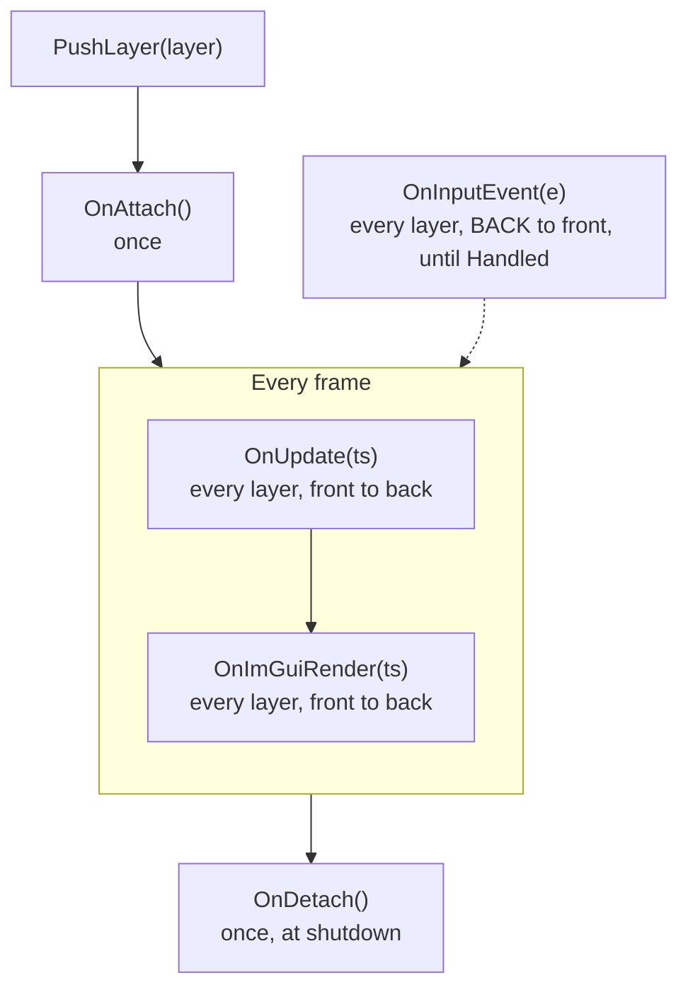

# Layer System

Layers are where your code lives. Every piece of update logic, UI and input handling is an `ILayer`.

> [!NOTE]
> **Mental model.** Think of the `LayerStack` as a pile of transparent sheets. Each sheet is a layer with five optional callbacks. Each frame the application walks the pile from the bottom up to update and draw. Input travels the other way: it falls from the top sheet downward, and the first sheet that claims it stops it.
>
> This page follows one layer through its life:
>
> 1. **What a layer is.** [The five callbacks](#the-five-callbacks)
> 2. **When each callback runs.** [A layer's life](#a-layers-life)
> 3. **What to put where.** [Update, draw, input](#update-draw-input)
> 4. **Where it sits in the pile.** [Layers and overlays](#layers-and-overlays)
> 5. **Who owns it.** [Ownership](#ownership)

## The five callbacks

`ILayer` is a base class whose virtual methods all have empty default bodies. Override only the ones you need:

| Callback | Called | Typical use |
|---|---|---|
| `OnAttach()` | Once, right after the layer is pushed | Allocate resources, subscribe to events |
| `OnDetach()` | Once, when the application shuts down | Release resources |
| `OnUpdate(TimeStep ts)` | Every frame | Simulation and state changes |
| `OnImGuiRender(TimeStep ts)` | Every frame, inside the ImGui frame | Draw UI |
| `OnInputEvent(RoutedInputEvent& e)` | For each input event, back to front | React to keys, mouse and window events |

A layer also has a name (`ILayer("MyLayer")`, read with `GetName()`) used for logging and profiling. A minimal layer:

```cpp
export module MyApp.MyLayer;

import nodens;

export class MyLayer : public Nodens::ILayer
{
public:
    MyLayer() : ILayer("MyLayer") {}

    void OnUpdate(Nodens::TimeStep ts) override { /* per-frame logic */ }
    void OnImGuiRender(Nodens::TimeStep ts) override { /* ImGui drawing */ }
};
```

Push it from your application's constructor with `PushLayer(new MyLayer());`. [Creating a Custom Layer](./creating-a-custom-layer.md) walks through a complete one.

## A layer's life



- **`OnAttach` runs inside `PushLayer`.** The application, window and event bus already exist, so `Application::Get().GetEventBus()` is safe to use there.
- **All `OnUpdate` calls finish before any `OnImGuiRender` starts.** The UI always draws the state produced by this frame's update.
- **`OnDetach` runs at shutdown.** `Application` has `PushLayer` and `PushOverlay` but no way to remove a layer, so a layer lives from its push until the application ends.

`TimeStep` is the time since the previous frame, as a `float`:

```cpp
void OnUpdate(Nodens::TimeStep ts) override
{
    float seconds = ts.GetSeconds();       // explicit
    float millis  = ts.GetMilliseconds();  // convenience
    m_Angle += 90.0f * ts;                 // implicit conversion to float
}
```

Multiply speeds by `ts` so motion takes the same time at any frame rate.

## Update, draw, input

- **State changes go in `OnUpdate`, drawing in `OnImGuiRender`.** `OnImGuiRender` runs only when the GUI is enabled (`EnableGUI = true`), so logic placed there stops running without a GUI.
- **Keep both cheap.** They run on the main thread every frame. Hand long work to the [Concurrency and TaskSystem](./concurrency-and-tasksystem.md).
- **`OnInputEvent` is for things that happen once**: a key press, a resize, a close request. For state that is held, poll from `OnUpdate` with `Nodens::Input::IsKeyPressed(...)` or `Input::GetMousePosition()`. [Event System](./event-system.md) shows how a layer consumes an event.

## Layers and overlays

`PushLayer` and `PushOverlay` differ only in where the layer lands:

- `PushLayer(layer)` inserts it **before** the overlay boundary.
- `PushOverlay(overlay)` appends it **after** everything else.

The stack is one list, `[layers ... | overlays ...]`. Push `A` then `B`, with the `ImGuiLayer` already present as an overlay:

| Position | Layer | Updated and drawn | Receives events |
|---|---|---|---|
| 0 | `A` | first | last |
| 1 | `B` | second | second |
| 2 | `ImGuiLayer` (overlay) | last | first |

`Application` pushes the `ImGuiLayer` as an overlay when `EnableGUI` is true, before your constructor body runs, so your `PushLayer` calls insert below it. ImGui therefore draws on top and sees every input event first, which lets it keep the keyboard or mouse while ImGui wants them. Use `PushOverlay` for your own always-on-top pieces, such as a debug HUD or an input filter that must run before your other layers.

## Ownership

Layers are passed as raw pointers, and the stack owns them:

```cpp
PushLayer(new MyLayer());   // The LayerStack now owns it and deletes it at shutdown.
```

The rule that comes with the short API: never `delete` a layer you pushed, and never use a pointer to it after the application ends. At shutdown the `LayerStack` calls `OnDetach()` on each layer and then deletes it.

`LayerStack::PopLayer` and `PopOverlay` exist but are not reachable through `Application`; they remove a layer without deleting it or calling `OnDetach`.

## See Also

- [Architecture Overview](./architecture-overview.md): where layers fit in the whole.
- [Creating a Custom Layer](./creating-a-custom-layer.md): a complete layer, step by step.
- [Event System](./event-system.md): how events reach layers.
