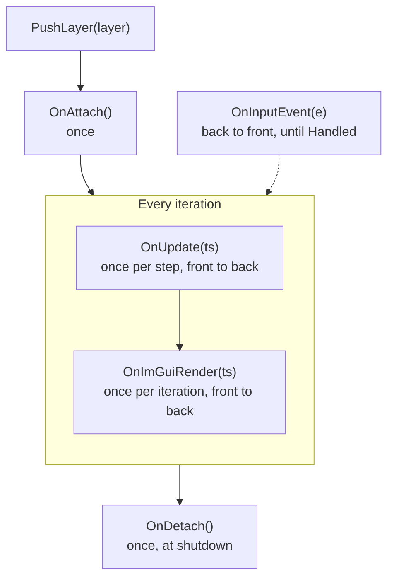

# Layer System

Layers are where your code lives. Every piece of update logic, UI and input handling belongs to an `ILayer`.

> [!NOTE]
> **Mental model.** The `LayerStack` is a pile of sheets. Each sheet is a layer with five optional callbacks. Every iteration the application walks the pile from the bottom up to update and draw. Input travels the other way: it falls from the top sheet downward, and the first sheet that claims an event stops it. The pile is fixed once the application starts, because a layer is never removed during a run.

## Problem

All per-iteration work needs a home, and the hard part is order: which code draws first, which code sees a key press first, and who owns the objects that both need.

A single update function answers none of those. Every feature edits the same function, two features that both want a key press have no rule for which wins, and nothing stops one feature from drawing before the state it draws has been computed.

## How it works

### The five callbacks

`ILayer` is a base class whose virtual methods have empty bodies. Override the ones you need:

| Callback | Called | Typical use |
|---|---|---|
| `OnAttach()` | Once, right after the layer is pushed | Allocate resources, subscribe to events |
| `OnDetach()` | Once, when the application shuts down | Release resources |
| `OnUpdate(TimeStep ts)` | Once per step | Simulation and state changes |
| `OnImGuiRender(TimeStep ts)` | Once per iteration, inside the ImGui frame | Draw UI |
| `OnInputEvent(RoutedInputEvent& e)` | For each input event, back to front | React to keys, mouse and window events |

A layer also carries a name, `ILayer("MyLayer")`, read with `GetName()`, which the logger and the profiler use. The smallest useful layer overrides two callbacks:

```cpp
export module MyApp.MyLayer;

import nodens;

export class MyLayer : public Nodens::ILayer
{
public:
    MyLayer() : ILayer("MyLayer") {}

    void OnUpdate(Nodens::TimeStep ts) override { /* per-step logic */ }
    void OnImGuiRender(Nodens::TimeStep ts) override { /* ImGui drawing */ }
};
```

Push it from the application's constructor with `PushLayer(new MyLayer());`. [Creating a Custom Layer](./creating-a-custom-layer.md) builds a complete one.

### A layer's life



- **`OnAttach` runs inside `PushLayer`.** The application, window and event bus already exist, so `Application::Get().GetEventBus()` is safe to use there.
- **Every `OnUpdate` finishes before any `OnImGuiRender` starts,** so the UI always draws the state this iteration produced.
- **`OnDetach` runs once, at shutdown.** `Application` offers `PushLayer` and `PushOverlay` but no way to remove a layer, so a layer lives from its push until the application ends.

`TimeStep` is the length of one step, in seconds, as a `float`. It is the measured time in variable pacing and `FixedDelta` in fixed pacing, so a layer reads a step length either way:

```cpp
void OnUpdate(Nodens::TimeStep ts) override
{
    float seconds = ts.GetSeconds();       // explicit
    float millis  = ts.GetMilliseconds();  // convenience
    m_Angle += 90.0f * ts;                 // implicit conversion to float
}
```

Multiply speeds by `ts`, so motion takes the same time at any rate.

### The stack and its order

`PushLayer` and `PushOverlay` differ only in where the layer lands:

- `PushLayer(layer)` inserts it **before** the overlay boundary.
- `PushOverlay(overlay)` appends it **after** everything else.

The stack is one list, `[layers ... | overlays ...]`. Push `A`, then `B`, with the `ImGuiLayer` already present as an overlay:

| Position | Layer | Updated and drawn | Receives events |
|---|---|---|---|
| 0 | `A` | first | last |
| 1 | `B` | second | second |
| 2 | `ImGuiLayer` (overlay) | last | first |

When the presentation is `EPresentation::WindowImGUI`, `Application` pushes the `ImGuiLayer` as an overlay before your constructor body runs, so your `PushLayer` calls insert below it. ImGui therefore draws on top and sees every input event first, which lets it keep the keyboard or mouse while ImGui wants them. Use `PushOverlay` for your own always-on-top pieces, such as a debug HUD or an input filter that must run before your other layers.

## What still goes wrong

**Logic placed in `OnImGuiRender`.** That callback runs only when there is an overlay, so in a headless run the logic disappears with the UI.

**Code that assumes one update per iteration.** With `EPacing::Fixed` an iteration runs zero, one or several steps, so a counter in `OnUpdate` counts steps, not iterations.

**An always-on-top piece pushed as a layer.** It draws before the overlay and receives input last, which is the opposite of what the author meant.

**A layer pointer kept after shutdown.** The stack deletes every layer it owns, so such a pointer is a dangling one.

**Long work in a callback.** Every callback runs on the main thread, so a slow one delays the window, the input and the present that follow it.

## Remedies

**Draw in `OnImGuiRender` and change state in `OnUpdate`.** The split is what keeps logic alive in a headless run, because only the drawing is missing.

**Treat `OnUpdate` as per step and multiply by `ts`.** Whatever must happen once per iteration belongs in `OnImGuiRender`, or must count its own steps.

**Push always-on-top pieces with `PushOverlay`.** The overlay region is the one that draws last and receives input first.

**Never delete a layer you pushed, and never use one after the application ends.** The stack owns it, detaches it and deletes it.

**Hand long work to `TaskSystem` and report back through a queued event.** [Concurrency and TaskSystem](./concurrency-and-tasksystem.md) explains the mechanics, and [Event System](./event-system.md) the reporting.

## A worked case

Three layers: `A` and `B` pushed with `PushLayer`, then the `ImGuiLayer` overlay. One iteration with a single key press looks like this:

| Order | What runs | In which order |
|---|---|---|
| 1 | `OnUpdate(ts)`, once per step | `A`, `B`, `ImGuiLayer` |
| 2 | `OnImGuiRender(ts)`, once per iteration | `A`, `B`, `ImGuiLayer` |
| 3 | `OnInputEvent(e)` for the key press | `ImGuiLayer`, `B`, `A`, stopping at the first layer that sets `Handled` |
| 4 | `OnDetach()`, at shutdown | once per layer |

Row 3 is the one that surprises people: the overlay sees the key first, and because it draws last it can claim the event and keep it from the layers below.

## Choosing

- **Layer or overlay?** Use `PushLayer` for application content, and `PushOverlay` for anything that must draw on top and see input first.
- **`OnUpdate` or `OnImGuiRender`?** State in `OnUpdate`, drawing in `OnImGuiRender`. Logic in the second one disappears without an overlay.
- **Poll or event?** Use `OnInputEvent` for things that happen once, such as a key press or a resize, and poll from `OnUpdate` with `Nodens::Input::IsKeyPressed(...)` for state that is held.

## Rules

1. Never delete a layer you pushed; the `LayerStack` owns it and deletes it at shutdown.
2. Keep callbacks cheap, because they run on the main thread.
3. Multiply by `ts`, and expect `OnUpdate` to run several times per iteration in fixed pacing.
4. Do not treat `LayerStack::PopLayer` or `PopOverlay` as part of the application API: they exist on the stack, are not reachable through `Application`, and remove a layer without calling `OnDetach`.

## See Also

- [Architecture Overview](./architecture-overview.md): where layers fit in the whole.
- [Creating a Custom Layer](./creating-a-custom-layer.md): a complete layer, step by step.
- [Event System](./event-system.md): how events reach layers.
